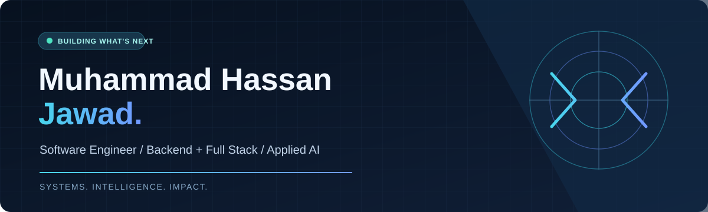

 

**I turn complex problems into software people can actually use.**

Building at the intersection of **backend engineering**, **full-stack products**, and **applied AI**.

Software Engineering student at **NUST SEECS** · Pakistan

 

---

## 01 / The work

I enjoy building systems end to end, from API and database design to user-facing experiences. Recently, much of my work has involved retrieval-augmented generation, real-time communication, and making AI systems useful in actual products.

<table>
<tr>
<td width="50%" valign="top">

### [SupportAI](https://github.com/MHassanJawad/support-ai)

**AI-powered customer support**

A multi-tenant support platform that turns uploaded business knowledge into grounded answers using RAG, embeddings, and vector search.

`Next.js` `Express` `Supabase` `pgvector` `Gemini`

[Explore the code](https://github.com/MHassanJawad/support-ai)

</td>
<td width="50%" valign="top">

### [Student Law Site](https://github.com/MHassanJawad/student-law-site)

**Making legal research more accessible**

A source-linked Pakistani law research platform with searchable judgments, original PDF viewing, and reviewed AI summaries.

`Next.js` `TypeScript` `PostgreSQL` `PDF.js`

[Explore the code](https://github.com/MHassanJawad/student-law-site) · [Live site](https://studentlawsite.netlify.app)

</td>
</tr>
<tr>
<td width="50%" valign="top">

### [Multilingual Video Calling](https://github.com/MHassanJawad/video-call-app)

**Communication without language barriers**

A two-person WebRTC calling app with speech transcription, language detection, and translated captions.

`WebRTC` `WebSockets` `Google Cloud APIs`

[Explore the code](https://github.com/MHassanJawad/video-call-app)

</td>
<td width="50%" valign="top">

### [Swift News Search Engine](https://github.com/MHassanJawad/search-engine)

**Search, ranked properly**

A news search engine built around inverted indexes, BM25 relevance ranking, and a FastAPI search endpoint.

`Python` `FastAPI` `BM25` `Information Retrieval`

[Explore the code](https://github.com/MHassanJawad/search-engine)

</td>
</tr>
</table>

**Also built:** [Interactive disease spread simulation](https://github.com/MHassanJawad/disease-spread-simulation) using an SIR model, Streamlit, and NetworkX.

---

## 02 / My toolkit

**Languages & frameworks**

**Data, infrastructure & AI**

---

## 03 / Research and exploration

**CardioTuneAI | Final-year research**

Exploring how to automatically select transmit-frequency offsets in cardiac bSSFP MRI to reduce dark-banding artifacts. The work combines medical image segmentation, visual feature extraction, and sequence-based ranking.

I have also worked on cardiac MRI segmentation and evidence-based chest X-ray AI experiments.

---

## 04 / A little more about me

- I care about the engineering behind the interface: maintainable APIs, reliable data flows, and practical architecture.
- I like building AI features that have a clear purpose, rather than adding AI just for the sake of it.
- I'm interested in backend, full-stack, and applied AI engineering opportunities.

---

### Have something interesting to build?

**I'm always up for a conversation about software, systems, and useful AI.**

Designed and maintained by Muhammad Hassan Jawad

